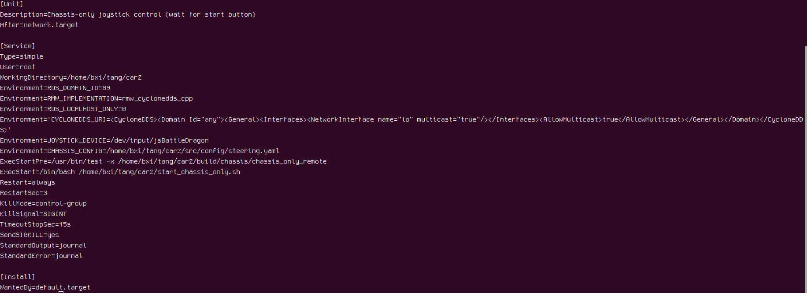

# Quickly Access Depth Camera Data

The ELF3 project publishes depth camera data through `bxi_depth_camera`, supporting Intel RealSense and Orbbec Gemini 335 cameras. Applications can subscribe to ROS 2 image topics to receive color images, depth images, and camera intrinsics without calling the vendor SDK directly.

This guide reads camera data on the robot host. Load the runtime environment, check the camera node and topics, then use Python to obtain RGB and depth arrays.

## 1. Load the Environment

Source code: [bxi_controller_ros2](https://github.com/bxirobotics/bxi_controller_ros2). Choose the project directory for your deployment. If your installation uses a different location, use the actual path on the robot.

| Deployment | Project directory |
|---|---|
| Source deployment / controller startup | `~/bxi_ws/bxi_rl_controller_ros2_example` |
| Prebuilt program downloaded by the App | `/opt/bxi/bxi_rl_controller_ros2_example` |

Load the ROS and project environments in every new terminal. The example below assumes a built source workspace; for an App deployment, replace the path after `cd`. If a new source deployment does not yet have `install/setup.bash`, load the ROS environment first, then build as described below:

```bash
source /opt/bxi/bxi_ros2_pkg/setup.bash
cd ~/bxi_ws/bxi_rl_controller_ros2_example
source install/setup.bash

ros2 pkg prefix bxi_depth_camera
```

On a development computer with a standard ROS 2 Humble installation, replace the first line with `source /opt/ros/humble/setup.bash` and use your own workspace directory. `ros2 pkg prefix` should print the camera package's installation path.

For a source deployment, install the project's build dependencies and run the build script from the project root before first use or after updating the source. Prebuilt programs downloaded through the App do not require this step. You do not need to rebuild every time you open a terminal.

```bash
cd ~/bxi_ws/bxi_rl_controller_ros2_example
bash build.sh
source install/setup.bash
```

To build only the camera package when its workspace dependencies are already available, run the following from the project root:

```bash
colcon build --merge-install --packages-select bxi_depth_camera
source install/setup.bash
```

After building, run `ros2 pkg prefix bxi_depth_camera` again to confirm the installation path.

The Python example below requires `rclpy`, `sensor_msgs`, `cv_bridge`, and `message_filters`. If these packages are missing from a standard Ubuntu 22.04 / ROS 2 Humble environment, install them with:

```bash
sudo apt install ros-humble-rclpy ros-humble-sensor-msgs \
  ros-humble-cv-bridge ros-humble-message-filters
```

## 2. Check and Start the Camera

### 2.1 Match the Service Environment for Controller Startup

If the robot runs through a controller and an automatic startup service, the terminal reading camera data must use the same ROS 2 communication environment as the service. Configure this before checking nodes to avoid mistaking an environment mismatch for a stopped camera. For manual camera startup, proceed to section 2.2.

Check the controller startup service's status and configuration:

```bash
systemctl status ros_elf_launch.service --no-pager
systemctl cat ros_elf_launch.service
```

If access is denied, prefix the relevant command with `sudo`. Subscribing to topics alone does not require switching to root. If you switch users, reload the environment from section 1 in the new terminal.

Check `ROS_DOMAIN_ID`, `RMW_IMPLEMENTATION`, `ROS_LOCALHOST_ONLY`, and `CYCLONEDDS_URI` in the service configuration. If a startup script sets these variables, also inspect the script referenced by `ExecStart`.

The screenshot below shows environment variables in a chassis startup service as an example of where to find these settings. Use the service paths, startup program, and variable values from your actual robot.



After loading the environment from section 1, set the variables in the data-reading terminal to match the actual service. For example, if the service uses domain ID `89` and CycloneDDS:

```bash
export ROS_DOMAIN_ID=89
export RMW_IMPLEMENTATION=rmw_cyclonedds_cpp
export ROS_LOCALHOST_ONLY=0
export CYCLONEDDS_URI='<CycloneDDS><Domain Id="any"><General><Interfaces><NetworkInterface name="lo" multicast="true"/></Interfaces><AllowMulticast>true</AllowMulticast></General></Domain></CycloneDDS>'
```

These settings apply only to the current terminal and processes launched from it. `89` is an example, not a value to use on every robot. The `lo` interface is the local loopback interface and is suitable for communication on the same host. Subscriptions across hosts require checking the network interfaces and DDS configuration on both ends.

### 2.2 Check Existing Nodes

Run these commands in the configured terminal:

```bash
ros2 node list
ros2 topic list
```

If `example_demo_hw.launch.py` is already running, it includes the camera node; use that existing node. Check for `/depth_camera_manager` and the topics in section 3, and confirm that depth alignment and frame synchronization are enabled.

### 2.3 Start the Camera Separately If It Is Not Running

After confirming that the camera node has not started, run the following command to enable color, depth, frame synchronization, and depth alignment:

```bash
ros2 launch bxi_depth_camera cameras.launch.py \
  enable_color:=true \
  enable_depth:=true \
  enable_sync:=true \
  align_depth.enable:=true
```

Keep this terminal running. Open another terminal, load the same runtime environment and communication settings, then read data as described below.

## 3. Check the Image Topics

A single camera without an explicit serial-number mapping uses the default name `head_depth_camera`:

| Data | Topic | Message type / encoding |
|---|---|---|
| Color image | `/hardware/head_depth_camera/color/image_raw` | `sensor_msgs/msg/Image`, `bgr8` |
| Depth image in the original depth-camera view | `/hardware/head_depth_camera/depth/image_rect_raw` | `sensor_msgs/msg/Image`, `16UC1` |
| Depth image aligned to color | `/hardware/head_depth_camera/aligned_depth_to_color/image_raw` | `sensor_msgs/msg/Image`, `16UC1` |
| Color camera intrinsics | `/hardware/head_depth_camera/color/camera_info` | `sensor_msgs/msg/CameraInfo` |
| Depth camera intrinsics | `/hardware/head_depth_camera/depth/camera_info` | `sensor_msgs/msg/CameraInfo` |
| Aligned depth camera intrinsics | `/hardware/head_depth_camera/aligned_depth_to_color/camera_info` | `sensor_msgs/msg/CameraInfo` |

List the actual topics, then check that images are arriving continuously:

```bash
ros2 topic list
ros2 topic hz /hardware/head_depth_camera/color/image_raw
```

## 4. Read Color and Depth Together in Python

Save the following code as `~/read_rgb_depth.py`. It pairs images by message timestamp, produces two NumPy arrays, `rgb` and `depth`, in the callback, and prints their dimensions and the center pixel's depth once per second.

```python
import rclpy
from rclpy.node import Node
from rclpy.qos import qos_profile_sensor_data
from sensor_msgs.msg import Image
from cv_bridge import CvBridge
from message_filters import Subscriber, ApproximateTimeSynchronizer


class CameraReader(Node):
    def __init__(self):
        super().__init__("camera_reader")
        camera_name = self.declare_parameter(
            "camera_name", "head_depth_camera"
        ).value
        # Meters per data unit; 0 means unspecified, so only raw values are printed.
        self.depth_scale = self.declare_parameter("depth_scale", 0.0).value
        self.bridge = CvBridge()
        base = f"/hardware/{camera_name}"

        self.color_sub = Subscriber(
            self, Image, base + "/color/image_raw",
            qos_profile=qos_profile_sensor_data,
        )
        self.depth_sub = Subscriber(
            self, Image, base + "/aligned_depth_to_color/image_raw",
            qos_profile=qos_profile_sensor_data,
        )
        self.sync = ApproximateTimeSynchronizer(
            [self.color_sub, self.depth_sub],
            queue_size=5,
            slop=0.03,  # Timestamp pairing tolerance: 30 ms.
        )
        self.sync.registerCallback(self.on_frames)

    def on_frames(self, color_msg, depth_msg):
        # rgb: uint8, shape (height, width, 3), with RGB channel order.
        rgb = self.bridge.imgmsg_to_cv2(color_msg, desired_encoding="rgb8")
        # depth: uint16, shape (height, width), preserving depth values.
        depth = self.bridge.imgmsg_to_cv2(
            depth_msg, desired_encoding="passthrough"
        )

        y, x = depth.shape[0] // 2, depth.shape[1] // 2
        raw = int(depth[y, x])  # Array indexing is [row y, column x].
        if raw == 0:
            value = "invalid"
        elif self.depth_scale > 0:
            value = f"{raw * self.depth_scale:.3f} m"
        else:
            value = f"{raw} (raw)"
        self.get_logger().info(
            f"RGB={rgb.shape}, depth={depth.shape}, center={value}",
            throttle_duration_sec=1.0,
        )
        # Process rgb and depth here, for example to detect objects or read pixel depth.


def main():
    rclpy.init()
    node = CameraReader()
    try:
        rclpy.spin(node)
    except KeyboardInterrupt:
        pass
    finally:
        node.destroy_node()
        if rclpy.ok():
            rclpy.shutdown()


if __name__ == "__main__":
    main()
```

Run it in a terminal with the environment from section 1 loaded. If using the controller startup service, also apply the communication settings from section 2.1:

```bash
/usr/bin/python3 ~/read_rgb_depth.py
```

Once images arrive, the output will look like this. Actual dimensions depend on the profiles negotiated with the device:

```text
RGB=(1080, 1920, 3), depth=(1080, 1920), center=1234 (raw)
```

`rgb[y, x]` contains the pixel's RGB color, and `depth[y, x]` contains its corresponding depth value. If subsequent processing uses OpenCV's BGR interfaces, change `desired_encoding="rgb8"` to `"bgr8"`. The example receives images using `qos_profile_sensor_data` and allows a timestamp difference of approximately 30 ms between the two streams. This is approximate pairing; it does not guarantee identical exposure times.

To select another logical camera name, such as `body_depth_camera` already mapped in your deployment:

```bash
/usr/bin/python3 ~/read_rgb_depth.py --ros-args \
  -p camera_name:=body_depth_camera
```

## 5. Convert Depth to Meters

`16UC1` means that each pixel contains an unsigned 16-bit integer; it does not determine the depth unit by itself. Confirm the depth scale for your camera and driver configuration before converting values:

```text
Depth (meters) = raw depth value × depth_scale
```

The example defaults to `depth_scale=0.0`, which prints only raw values. If you have confirmed that each depth unit is 1 millimeter, set the scale to `0.001`:

```bash
/usr/bin/python3 ~/read_rgb_depth.py --ros-args \
  -p depth_scale:=0.001
```

A raw value of `1234` then corresponds to `1.234 m`. The example treats a raw value of `0` as invalid depth; do not use it as a target distance.

## Troubleshooting

| Symptom | What to check |
|---|---|
| `bxi_depth_camera` cannot be found | Confirm that your deployment includes the package and that you sourced its `install/setup.bash`. For a source deployment, build it as described in section 1. |
| No camera topics | For controller startup, first check the communication environment as described in section 2.1. Then check power, USB connections, and device enumeration using the commands below. |
| Device permission error | On first deployment, run `ros2 run bxi_depth_camera install-udev-rules`, then reconnect the camera after installing the rules. |
| Camera names differ from the example with multiple cameras | Check `ros2 topic list` and use `camera_name` to select the actual logical name or `SN_<serial>`. |
| High processing or transmission latency | Use `cameras-inspect` to list supported profiles, then choose a lower-resolution `rgb_camera.color_profile`. Aligned depth dimensions follow the color resolution. |

### Check USB Connections and Devices

Run these commands on the robot to check the USB link speed and whether the camera is recognized:

```bash
lsusb -t
cameras-inspect
```

Find the camera's USB branch in the `lsusb -t` output and check whether its link speed is `5000M` (5 Gbit/s, USB 3.0) or higher. A value of `480M` indicates a USB 2.0 connection. Check the USB port, cable, and any intermediate devices, and confirm that the camera has adequate power.

You can also check for video device nodes:

```bash
ls /dev/video*
```

These nodes may belong to other devices. Their presence alone does not confirm that the depth camera is working; also check the enumeration results from `cameras-inspect` and the camera node logs.

### Subscribe Across Hosts

The current controller startup program uses local loopback communication by default, which supports reading data on the robot itself. To subscribe from another computer, launch the camera program from a separate terminal on the robot and configure network connectivity, matching `ROS_DOMAIN_ID` values, and DDS communication settings on both the publisher and subscriber.

For this separate launch, replace the example configuration bound to `lo` in section 2.1 with the actual network interface. First confirm that the original service is not occupying the camera to avoid starting duplicate instances. Starting a subscriber on another computer alone does not expose topics that use loopback communication.
