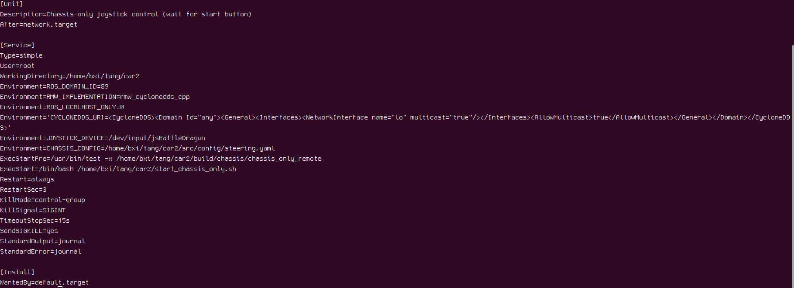

# 快速获取深度相机数据

ELF3 工程通过 `bxi_depth_camera` 发布深度相机数据，支持 Intel RealSense 和 Orbbec Gemini 335。应用程序订阅 ROS 2 图像话题即可取得彩色图、深度图和相机内参，无需直接调用厂商 SDK。

本文以在机器人本机读取相机数据为例。先加载运行环境，再确认相机节点与话题，最后使用 Python 获取 RGB 和深度数组。

## 1. 加载运行环境

工程源码：[bxi_controller_ros2](https://github.com/bxirobotics/bxi_controller_ros2)。请根据实际部署方式选择工程目录；若安装位置不同，以机器人上的实际路径为准。

| 部署方式 | 工程目录 |
|---|---|
| 源码部署 / 手柄启动 | `~/bxi_ws/bxi_rl_controller_ros2_example` |
| App 下载的预编译程序 | `/opt/bxi/bxi_rl_controller_ros2_example` |

每个新终端都需要先加载 ROS 和工程环境。下面以已编译的源码部署为例；App 部署时替换 `cd` 后的路径。首次源码部署若尚未生成 `install/setup.bash`，先加载 ROS 环境，再按下方说明完成编译：

```bash
source /opt/bxi/bxi_ros2_pkg/setup.bash
cd ~/bxi_ws/bxi_rl_controller_ros2_example
source install/setup.bash

ros2 pkg prefix bxi_depth_camera
```

使用标准 ROS 2 Humble 安装的开发电脑时，第一行改为 `source /opt/ros/humble/setup.bash`，工程目录也替换为自己的工作空间。`ros2 pkg prefix` 应输出相机包的安装位置。

源码部署首次使用或更新源码后，应先安装工程构建依赖，再在工程根目录执行构建脚本。App 下载的预编译程序无需执行此步骤，每次打开新终端时也无需重复编译。

```bash
cd ~/bxi_ws/bxi_rl_controller_ros2_example
bash build.sh
source install/setup.bash
```

如果仅需编译相机包，且工作空间中的相关依赖已就绪，也可在工程根目录执行：

```bash
colcon build --merge-install --packages-select bxi_depth_camera
source install/setup.bash
```

构建完成后，再运行 `ros2 pkg prefix bxi_depth_camera` 确认安装位置。

下文 Python 示例需要 `rclpy`、`sensor_msgs`、`cv_bridge` 和 `message_filters`。标准 Ubuntu 22.04 / ROS 2 Humble 环境若缺少这些包，可以安装：

```bash
sudo apt install ros-humble-rclpy ros-humble-sensor-msgs \
  ros-humble-cv-bridge ros-humble-message-filters
```

## 2. 检查并启动相机

### 2.1 遥控器启动时，先匹配服务环境

如果机器人通过遥控器和自启动服务运行，读取数据的终端需要使用与服务一致的 ROS 2 通信环境。请先完成本节配置，再检查节点，避免因环境不一致而误判相机未启动。手动启动相机时，可直接进入第 2.2 节。

查看遥控器启动服务的状态和配置：

```bash
systemctl status ros_elf_launch.service --no-pager
systemctl cat ros_elf_launch.service
```

若提示权限不足，在相应命令前加 `sudo`。无需仅为订阅话题而切换到 root；如果切换了用户，需要在新终端中重新加载第 1 节的环境。

重点检查服务中的 `ROS_DOMAIN_ID`、`RMW_IMPLEMENTATION`、`ROS_LOCALHOST_ONLY` 和 `CYCLONEDDS_URI`。如果这些变量由启动脚本设置，还需查看服务 `ExecStart` 指向的脚本。

下图是底盘启动服务的环境变量示例，仅用于说明配置位置。服务路径、启动程序和变量值应以当前机器人的实际配置为准。



在用于读取相机数据的终端中，加载第 1 节环境后，再按实际服务配置设置变量。例如，服务使用域 ID `89` 和 CycloneDDS 时：

```bash
export ROS_DOMAIN_ID=89
export RMW_IMPLEMENTATION=rmw_cyclonedds_cpp
export ROS_LOCALHOST_ONLY=0
export CYCLONEDDS_URI='<CycloneDDS><Domain Id="any"><General><Interfaces><NetworkInterface name="lo" multicast="true"/></Interfaces><AllowMulticast>true</AllowMulticast></General></Domain></CycloneDDS>'
```

这些设置仅对当前终端及其启动的进程生效。`89` 是示例值，不能直接用于所有机器人。示例中的 `lo` 是本机回环网卡，适用于同机通信；跨主机订阅时，需要另行检查服务端与订阅端的网卡和 DDS 网络配置。

### 2.2 检查现有节点

在配置好环境的终端中运行：

```bash
ros2 node list
ros2 topic list
```

如果已经运行 `example_demo_hw.launch.py`，其中已包含相机节点，请直接使用现有节点。确认 `/depth_camera_manager` 及第 3 节的话题是否存在，并检查深度对齐与帧同步是否已开启。

### 2.3 未运行时，单独启动相机

确认相机节点尚未启动后，执行以下命令，开启彩色图、深度图、帧同步和深度对齐：

```bash
ros2 launch bxi_depth_camera cameras.launch.py \
  enable_color:=true \
  enable_depth:=true \
  enable_sync:=true \
  align_depth.enable:=true
```

保持这个终端运行。另开一个终端，加载相同的运行环境和通信配置，再按下文读取数据。

## 3. 确认图像话题

单台未配置序列号映射的相机默认命名为 `head_depth_camera`：

| 数据 | 话题 | 消息类型 / 编码 |
|---|---|---|
| 彩色图 | `/hardware/head_depth_camera/color/image_raw` | `sensor_msgs/msg/Image`，`bgr8` |
| 原深度视角的深度图 | `/hardware/head_depth_camera/depth/image_rect_raw` | `sensor_msgs/msg/Image`，`16UC1` |
| 对齐到彩色图的深度图 | `/hardware/head_depth_camera/aligned_depth_to_color/image_raw` | `sensor_msgs/msg/Image`，`16UC1` |
| 彩色相机内参 | `/hardware/head_depth_camera/color/camera_info` | `sensor_msgs/msg/CameraInfo` |
| 深度相机内参 | `/hardware/head_depth_camera/depth/camera_info` | `sensor_msgs/msg/CameraInfo` |
| 对齐深度的相机内参 | `/hardware/head_depth_camera/aligned_depth_to_color/camera_info` | `sensor_msgs/msg/CameraInfo` |

查看实际话题，再检查是否持续收到图像：

```bash
ros2 topic list
ros2 topic hz /hardware/head_depth_camera/color/image_raw
```

## 4. Python 同时读取彩色图和深度图

将下面代码保存为 `~/read_rgb_depth.py`。示例按消息时间戳配对图像，在回调中得到 `rgb` 和 `depth` 两个 NumPy 数组，并每秒输出一次尺寸及中心像素深度。

```python
import rclpy
from rclpy.node import Node
from rclpy.qos import qos_profile_sensor_data
from sensor_msgs.msg import Image
from cv_bridge import CvBridge
from message_filters import Subscriber, ApproximateTimeSynchronizer


class CameraReader(Node):
    def __init__(self):
        super().__init__("camera_reader")
        camera_name = self.declare_parameter(
            "camera_name", "head_depth_camera"
        ).value
        # 米 / 数据单位；0 表示尚未指定，只输出原始值。
        self.depth_scale = self.declare_parameter("depth_scale", 0.0).value
        self.bridge = CvBridge()
        base = f"/hardware/{camera_name}"

        self.color_sub = Subscriber(
            self, Image, base + "/color/image_raw",
            qos_profile=qos_profile_sensor_data,
        )
        self.depth_sub = Subscriber(
            self, Image, base + "/aligned_depth_to_color/image_raw",
            qos_profile=qos_profile_sensor_data,
        )
        self.sync = ApproximateTimeSynchronizer(
            [self.color_sub, self.depth_sub],
            queue_size=5,
            slop=0.03,  # 时间戳配对容差为 30 ms。
        )
        self.sync.registerCallback(self.on_frames)

    def on_frames(self, color_msg, depth_msg):
        # rgb: uint8，形状为 (高度, 宽度, 3)，通道顺序为 RGB。
        rgb = self.bridge.imgmsg_to_cv2(color_msg, desired_encoding="rgb8")
        # depth: uint16，形状为 (高度, 宽度)，保留深度数值。
        depth = self.bridge.imgmsg_to_cv2(
            depth_msg, desired_encoding="passthrough"
        )

        y, x = depth.shape[0] // 2, depth.shape[1] // 2
        raw = int(depth[y, x])  # 数组索引为 [行 y, 列 x]。
        if raw == 0:
            value = "invalid"
        elif self.depth_scale > 0:
            value = f"{raw * self.depth_scale:.3f} m"
        else:
            value = f"{raw} (raw)"
        self.get_logger().info(
            f"RGB={rgb.shape}, depth={depth.shape}, center={value}",
            throttle_duration_sec=1.0,
        )
        # 在这里处理 rgb 和 depth，例如识别目标或读取目标像素深度。


def main():
    rclpy.init()
    node = CameraReader()
    try:
        rclpy.spin(node)
    except KeyboardInterrupt:
        pass
    finally:
        node.destroy_node()
        if rclpy.ok():
            rclpy.shutdown()


if __name__ == "__main__":
    main()
```

在已完成第 1 节环境加载的终端中运行；若使用遥控器启动服务，还需完成第 2.1 节的通信环境配置：

```bash
/usr/bin/python3 ~/read_rgb_depth.py
```

收到图像后会输出类似下面的日志，实际尺寸以设备协商结果为准：

```text
RGB=(1080, 1920, 3), depth=(1080, 1920), center=1234 (raw)
```

`rgb[y, x]` 是该像素的 RGB 颜色，`depth[y, x]` 是对应的深度数值。若后续使用 OpenCV 的 BGR 接口，将 `desired_encoding="rgb8"` 改为 `"bgr8"`。示例使用 `qos_profile_sensor_data` 接收图像，并允许两路时间戳相差最多约 30 ms；这属于近似配对，不保证曝光时刻完全一致。

指定其他逻辑相机名称时，例如部署中已映射的 `body_depth_camera`：

```bash
/usr/bin/python3 ~/read_rgb_depth.py --ros-args \
  -p camera_name:=body_depth_camera
```

## 5. 将深度数值换算为米

`16UC1` 表示每个像素保存一个 16 位无符号整数，并不单独确定深度单位。请根据实际相机和驱动配置确认深度比例，再进行换算：

```text
深度（米）= 原始深度值 × depth_scale
```

示例脚本的 `depth_scale` 默认为 `0.0`，此时仅输出原始值。若已确认每个深度单位为 1 毫米，可设置为 `0.001`：

```bash
/usr/bin/python3 ~/read_rgb_depth.py --ros-args \
  -p depth_scale:=0.001
```

此时原始值 `1234` 对应 `1.234 m`。原始值为 `0` 时，示例将其视为无效深度，不应作为目标距离使用。

## 常见问题

| 现象 | 检查方法 |
|---|---|
| 找不到 `bxi_depth_camera` | 确认部署版本包含该包，且已加载对应的 `install/setup.bash`；源码部署可按第 1 步构建。 |
| 没有相机话题 | 遥控器启动时，先按第 2.1 节检查通信环境；再检查相机供电、USB 连接和设备枚举情况，具体命令见下文。 |
| 报设备权限错误 | 首次部署可运行 `ros2 run bxi_depth_camera install-udev-rules`，安装规则后重新插拔相机。 |

### USB 连接与设备检查

在机器人上运行以下命令，检查 USB 连接速率及相机是否被识别：

```bash
lsusb -t
cameras-inspect
```

在 `lsusb -t` 的输出中，找到相机所在的 USB 分支，检查连接速率是否为 `5000M`（5 Gbit/s，USB 3.0）或更高。若只显示 `480M`，说明当前以 USB 2.0 速率连接，应检查 USB 接口、线缆和中间连接设备，同时确认相机供电正常。

也可辅助查看系统中的视频设备节点：

```bash
ls /dev/video*
```

视频设备节点可能属于其他设备，不能仅凭其存在就确认深度相机工作正常；仍需结合 `cameras-inspect` 的枚举结果和相机节点日志判断。

### 跨主机订阅

当前遥控器启动程序默认使用本机回环通信，适用于在机器人本机读取数据。若需要在另一台电脑上订阅，应在机器人上通过独立终端启动相机程序，并为发布端和订阅端配置可互通的网络、匹配的 `ROS_DOMAIN_ID` 及 DDS 通信设置。

独立启动时，不要继续使用第 2.1 节中绑定 `lo` 的示例配置，应改用实际通信网卡。先确认原服务未占用相机，避免重复启动；仅在另一台电脑上启动订阅脚本，并不能让回环通信中的话题对外可见。