# ELF3 导航 App 使用教程

本文介绍如何为 ELF3 配置 Livox MID-360s 激光雷达，并通过 `bxi_rc_app` 完成建图、地图编辑和导览。

项目参考：[bxi_nav](https://github.com/Luckyt1/bxi_nav)

## 准备工作

- 安装最新版 `bxi_rc_app`。
- 准备一台已安装 Livox MID-360s 激光雷达的 ELF3 机器人。
- 确保 `bxi_rc_slam` 和 `bxi_rc_ros2`包已更新至最新版本。(注意最好先更新bxi_rc_ros2 来保证环境完整)
- 使用网线连接电脑与雷达。
- 确保作业区域安全、通道畅通。

## 1. 配置 Livox MID-360s 雷达

雷达无法启动时，通常是网络或雷达配置不正确。请先确认电脑与雷达处于同一网段，再检查 App 中的雷达网络配置。

### 1.1 配置静态 IP

将电脑网口设置为静态 IP，例如 `192.168.1.51`。建议使用网线直连雷达进行配置；在远程桌面环境中修改网络设置时，可能会遇到权限问题。

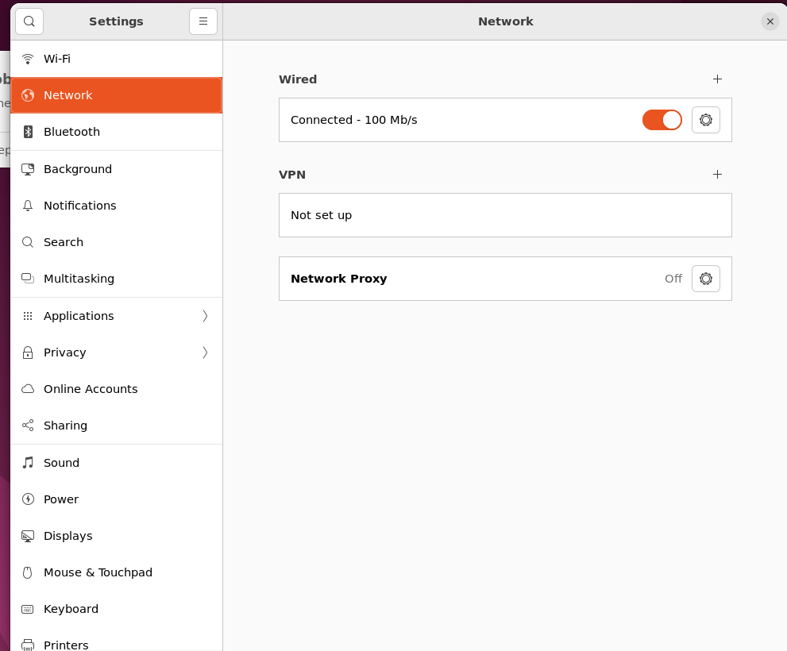

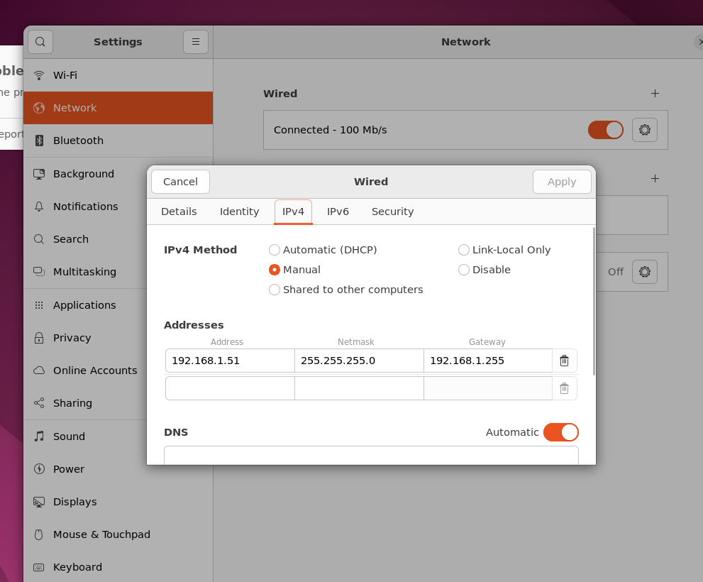

### 1.2 在 App 中配置雷达

1. 打开 `bxi_rc_app`，连接机器人后，在机器人详情页点击 **地图管理**，再点击 **新建地图** 进入建图页面。

    

2. 点击建图页面右上角的 **设置** 图标（下图红圈处）。

    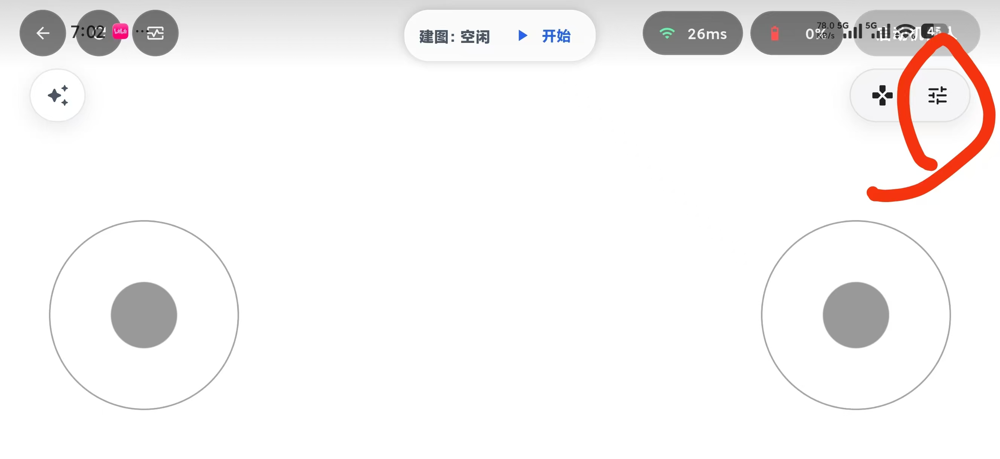

3. 在设置页面选择 **雷达**。在 **可用网卡地址** 中，点击与雷达相连的机器人网卡，将其地址填入 **机器人接收 IP**。

    下图中的有线网卡为 `enp86s0`，接收 IP 为 `192.168.1.52`。请以实际网卡地址为准，不要直接照抄示例，也不要将接收 IP 与雷达 IP 混淆。

    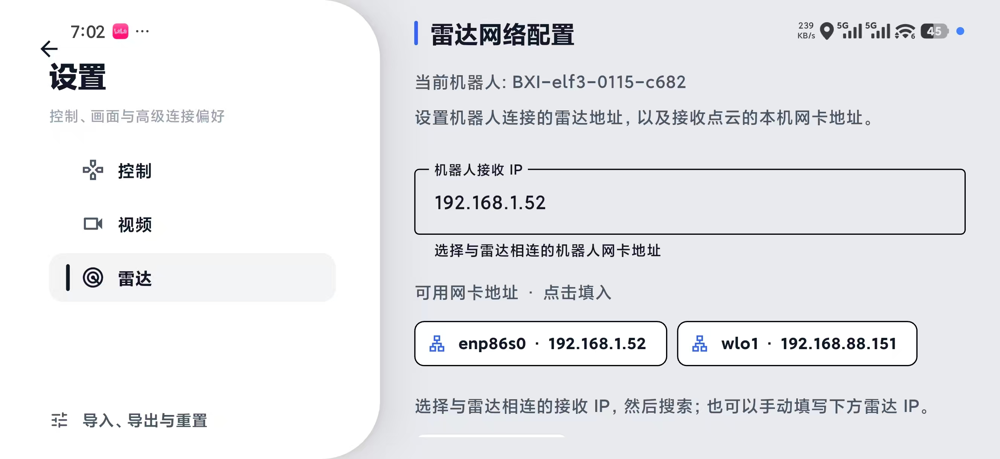

4. 点击 **搜索雷达**，在搜索结果中选择对应的雷达，将地址填入 **雷达 IP**。如果已知雷达的实际 IP，也可以手动填写。

    下图中搜索到的 MID360S 雷达 IP 为 `192.168.1.100`，请以实际搜索结果为准。

    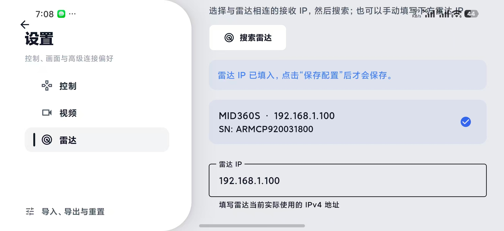

5. 确认 **机器人接收 IP** 和 **雷达 IP** 无误后，点击 **保存配置**。等待保存成功的提示，再重启机器人。

6. 重启完成后，重新连接机器人并返回建图页面。确认头部雷达竖直向下、机身保持稳定后，点击顶部的 **开始**。界面中出现红色点云，说明已正常接收到雷达数据，雷达配置完成。

    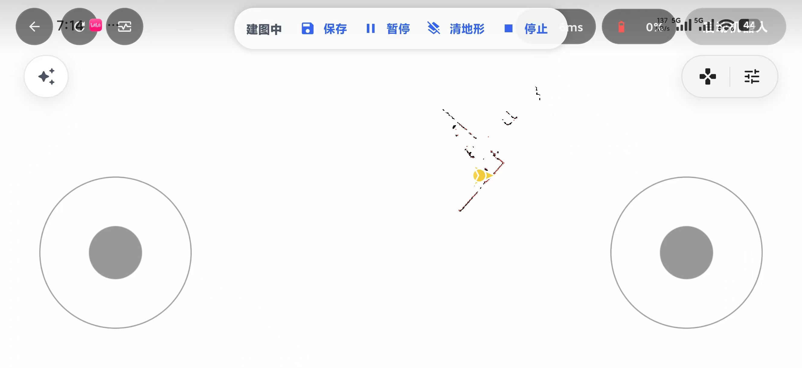

## 2. 使用导航 App

!!! warning "注意：确认头部雷达朝向"

    在进入建图或导航界面前，请确保机器人头部雷达**竖直向下**。

1. 打开 `bxi_rc_app`，点击 **我的设备**。

   

2. 在设备列表中选择需要导航的机器人，进入机器人详情页。

   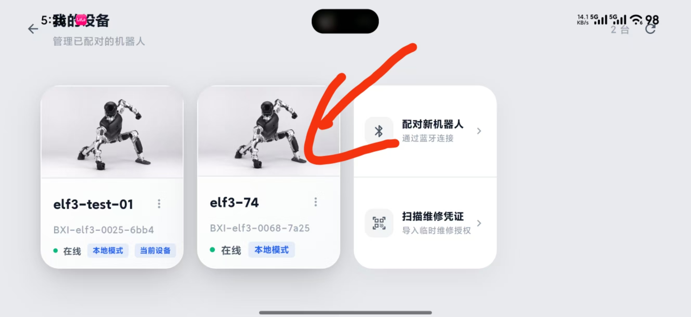

3. 在机器人详情页中进入 **地图管理**。

   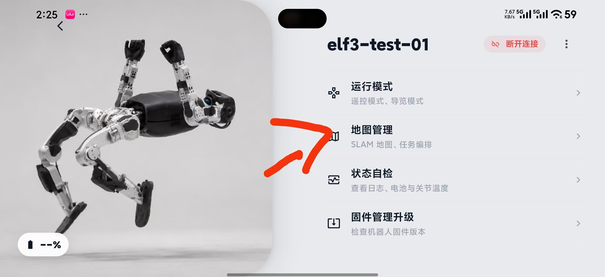

### 2.1 建图

!!! warning "启动建图前保持机器人稳定"

    请将机器人头部摆正并保持机身稳定，避免大幅晃动导致 IMU 初始化异常。

建图全流程演示：

1. 进入 **地图管理**，点击 **新建地图**。

   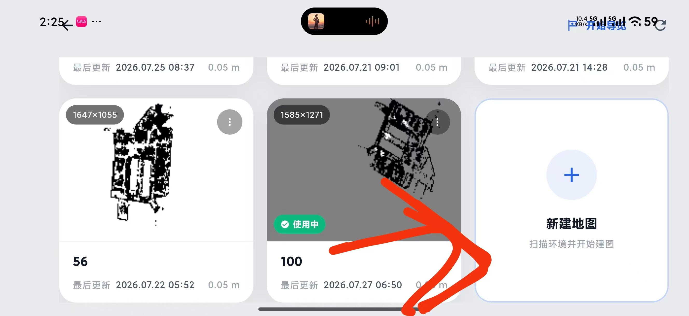

2. 启动机器人并保持走路模式。确认界面中能正常显示点云后，点击 **开始建图**。

   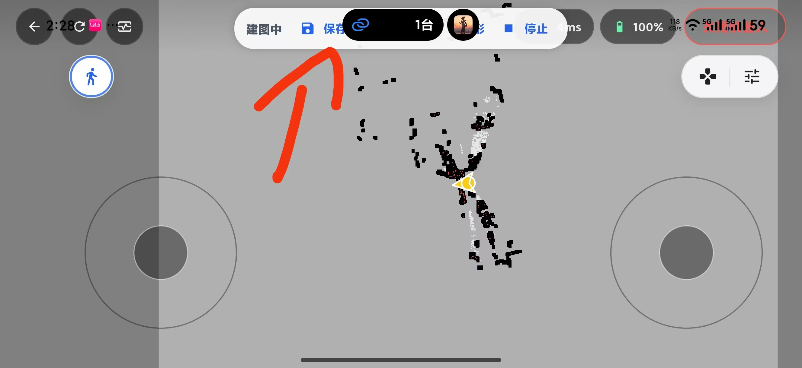

3. 建图时，请站在机器人后方，遥控机器人遍历目标区域，并尽量减少现场人员走动，避免人员被扫描进地图。

    新版本已支持动态障碍物过滤。若人员或其他动态障碍物被扫描进地图，待其离开后，遥控机器人重新扫描受影响区域，以过滤地图中的动态障碍物残留。

4. 地图覆盖目标区域后，点击 **保存**。等待界面确认地图保存成功，再退出建图页面。

   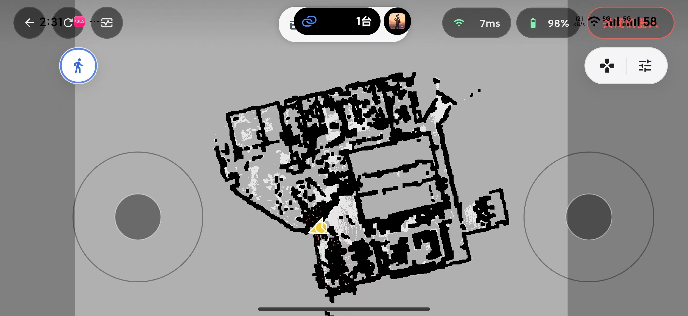

   

### 2.2 编辑地图

导览编辑演示：

1. 在 **地图管理** 中选择刚刚保存的地图。

   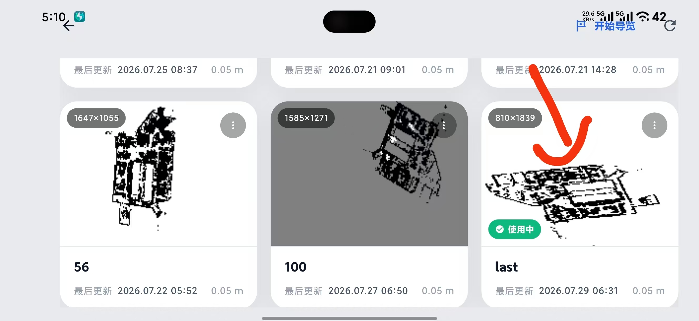

2. 进入导览编辑，切换到 **航点**，然后在地图上标记需要到达的位置。

   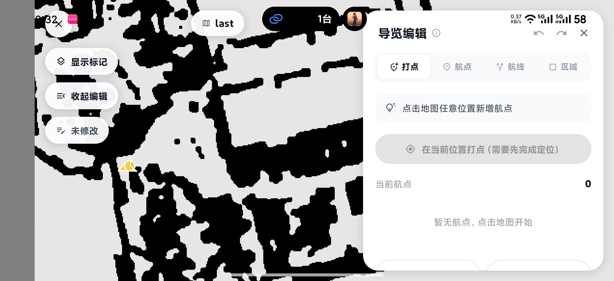

3. 为每个航点设置机器人到达后的朝向，并根据需要填写航点名称。

   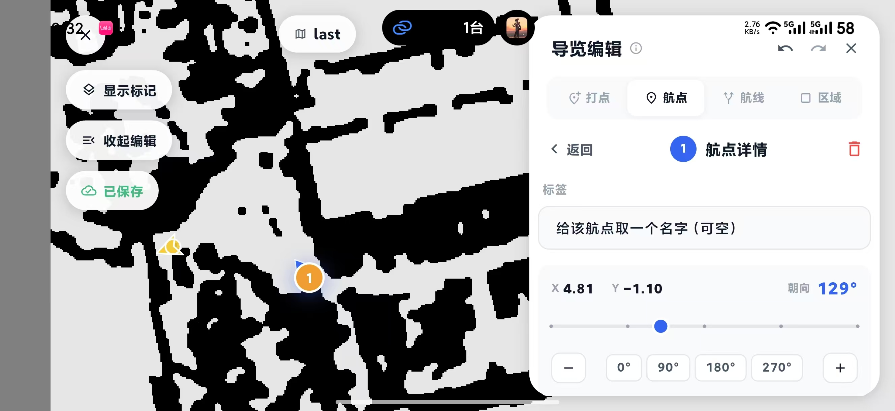

4. （可选）如需机器人到达航点后执行指定行为，点击 **添加动作**，选择 **语音**、**动作** 或 **延迟**，完成配置后点击 **添加**。可根据任务需要为同一航点添加多个行为。

   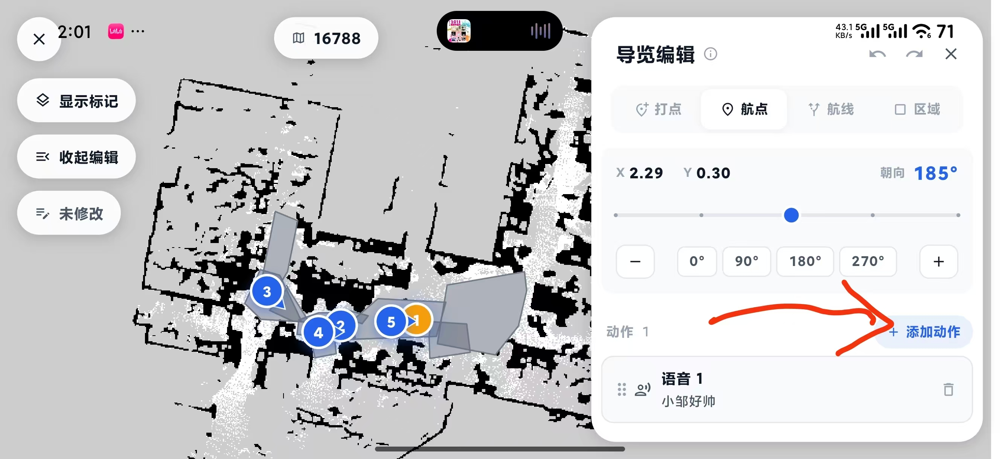

   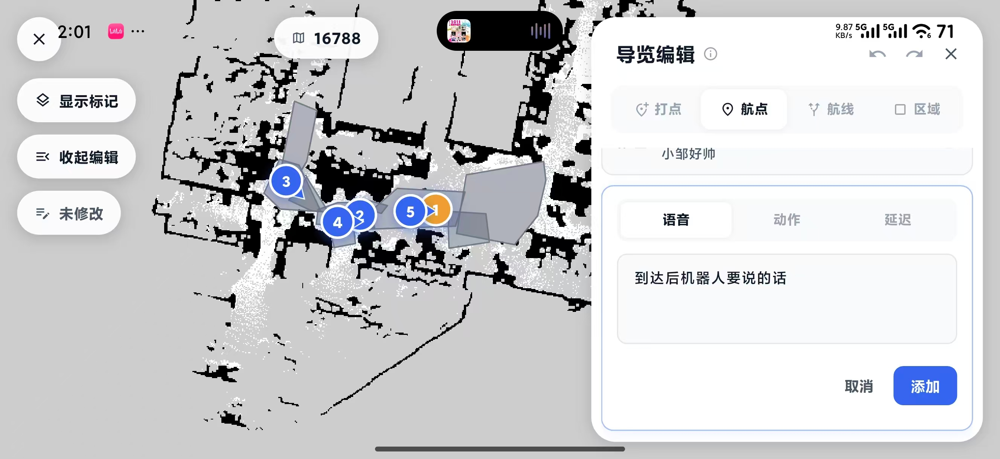

5. 切换到 **区域**，点击 **添加清除区**。让清除区覆盖机器人的行走通道，用于清除地图中实际已不存在的障碍物。

   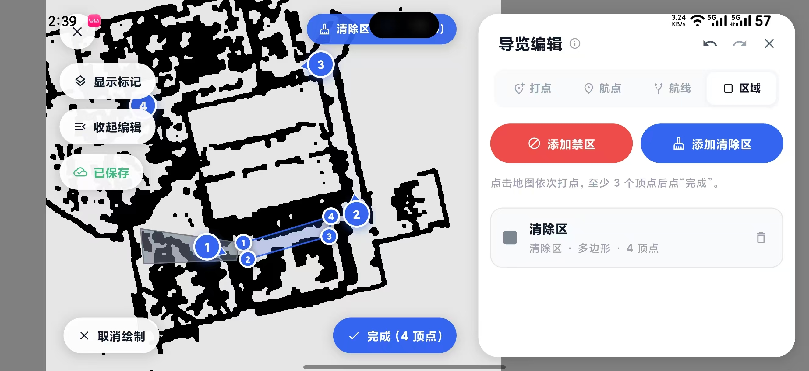

6. 确认航点、朝向、到达行为和清除区设置无误，并等待地图保存成功。

### 2.3 开始导览

!!! warning "启动导览前保持机器人稳定"

    请将机器人头部摆正并保持机身稳定，避免大幅晃动导致 IMU 初始化异常。

1. 返回机器人详情页，进入 **运行模式**，选择导览模式。

   

2. 选择需要使用的地图，并点击该地图的 **开始**。

   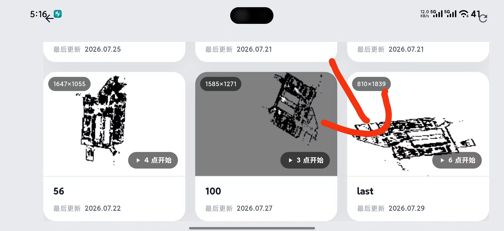

3. 点击 **重定位**，支持自动和手动两种方式。可先使用自动重定位；如果长时间无法完成定位，请切换为手动重定位，在地图上点击机器人的大致位置，并沿机器人当前朝向拖动定位标记。

   自动重定位演示：

   

   手动重定位演示：

   

4. 检查机器人周围的红色点云是否与地图墙壁重合。重合后点击 **确认**；如果偏差明显，请重新调整位置和方向。

   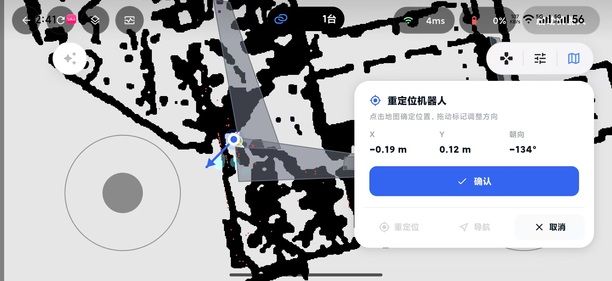

5. 点击 **导航** 开始执行导览任务。

   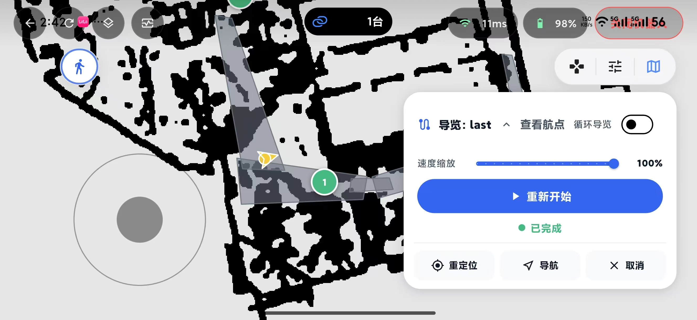

6. 导览过程中如出现异常，立即点击 **暂停** 或 **终止**。也可以使用界面中的遥杆临时接管机器人，避免机器人继续偏离路线。

   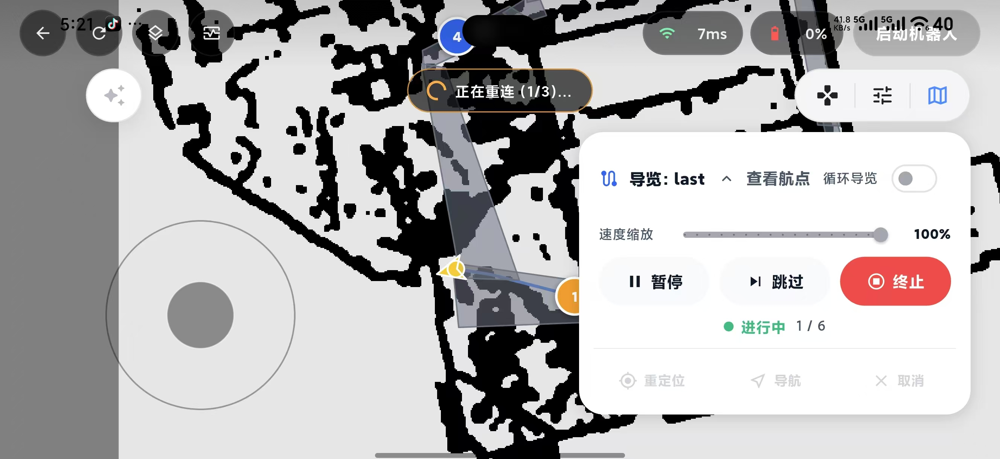

7. 导览完成后，先停止导航，再退出当前页面。

## 常见问题

### 如何调整遥控速度

1. 进入机器人遥控页面，点击右上角的 **设置** 图标。

   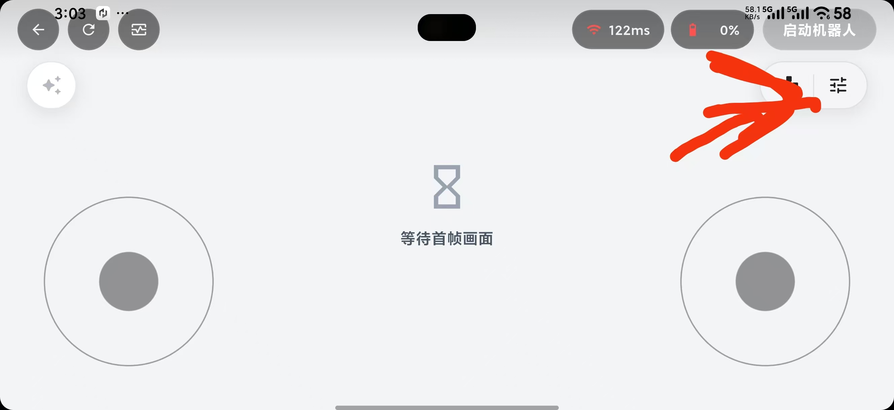

2. 在设置页面中选择 **控制**，根据需要调整以下参数：

   - **速度输出范围**：限制前进和后退的线速度，同时作用于屏幕虚拟摇杆和外接手柄。
   - **旋转输出范围**：限制左右转向的旋转速度，同时作用于屏幕虚拟摇杆和外接手柄。

   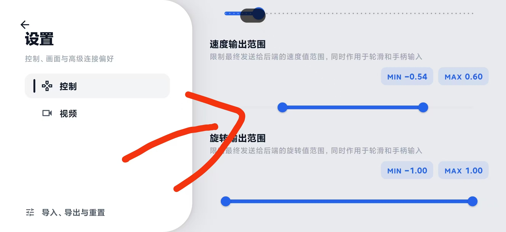

调整后先在空旷、安全的区域低速测试，确认机器人运动符合预期后再逐步提高速度。

### 雷达无法启动

- 确认电脑与雷达使用网线连接，并处于同一网段。
- 确认 App 中的 **机器人接收 IP** 与机器人上连接雷达的网卡 IP 一致。
- 确认 **雷达 IP** 与搜索到的雷达实际 IP 一致，且与接收 IP 处于同一网段。
- 确认配置已保存成功，并已重启机器人。

### 地图中出现人员或动态障碍物

- 建图人员应始终站在机器人后方。
- 建图期间减少现场人员走动。
- 若人员或动态障碍物已被扫描进地图，待其离开后，遥控机器人重新扫描受影响区域，利用新版本的动态障碍物过滤功能清除残留。
- 对实际已不存在的障碍物，可在地图编辑中添加清除区。

### 重定位后点云与墙壁不重合

- 重新选择机器人在地图中的位置。
- 调整定位标记，使其方向与机器人实际朝向一致。
- 确认红色点云与墙壁基本重合后，再开始导航。
