# ELF 3 Whole-Body Zero-Position Calibration Guide

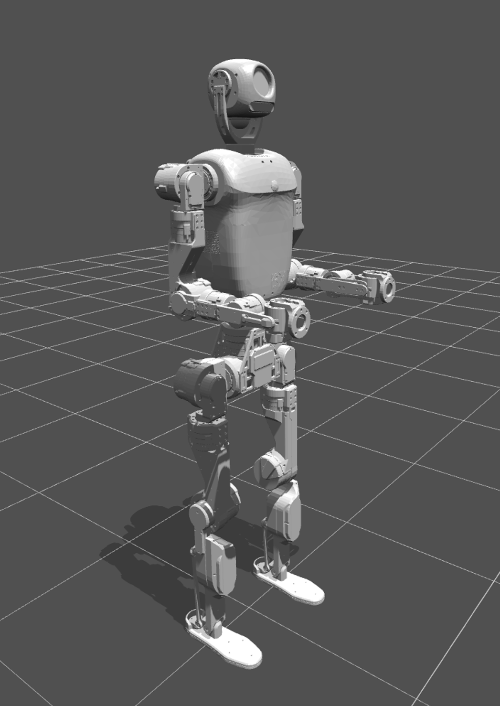{ width="400" }

## 1. Overview

The ELF 3 robot is calibrated for whole-body zero positions at the factory. If a joint module is later removed and reinstalled, changes in its mounting position may cause its actual zero position to become misaligned. The joint module must therefore be recalibrated. The main steps are:

1. **Secure the joints**: Lock the joint modules in place using locating pins and fixtures.
2. **Set zero positions**: Power on and issue calibration commands to update the zero-position parameters.
3. **Verify the result**: Remove the locating pins and fixtures, command the robot to its zero-position pose, and check that the pose is correct.

## 2. Locating Pin and Fixture Positions

The ELF 3 has 31 joint modules. Except for the two head joint modules, all 29 remaining joint modules have mounting positions for locating pins or fixtures, as shown below.

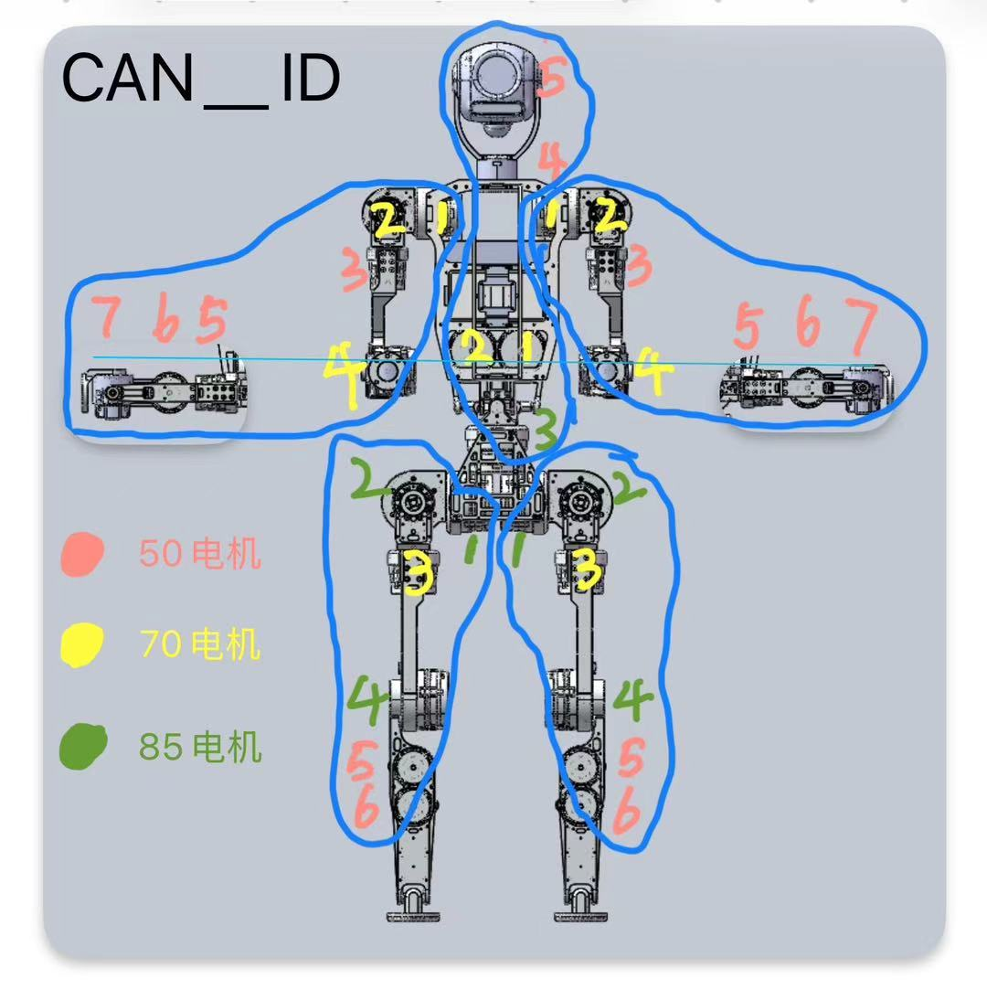{ width="600" }

## 3. Installing Arm Joint Locating Pins

Insert the locating pins into the zero-position locating slots of each arm joint module. Labels ①–⑦ in the image identify the seven joint modules from the right shoulder to the wrist. After inserting all pins, check each one to ensure it is seated securely. The joints must be locked and unable to rotate. Follow the same procedure for the left arm.

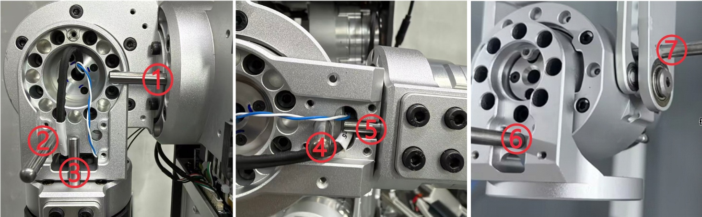

## 4. Installing Waist Joint Fixtures

### 1. Install the Fixtures for Waist Joints 1 and 2

The fixtures for waist joint modules 1 and 2 are mounted on the left and right sides. Install two identical fixtures, one on each side.

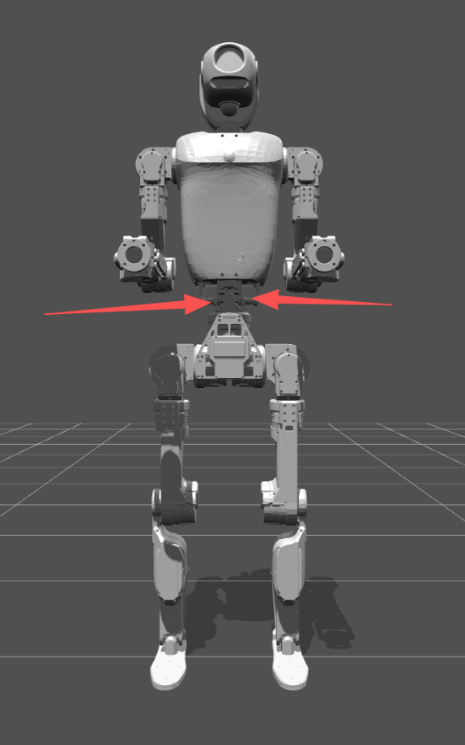{ width="400" }

### 2. Secure the Fixtures

Secure the locating fixture for waist joint modules 1 and 2 with four screws. Use the same method on both sides.

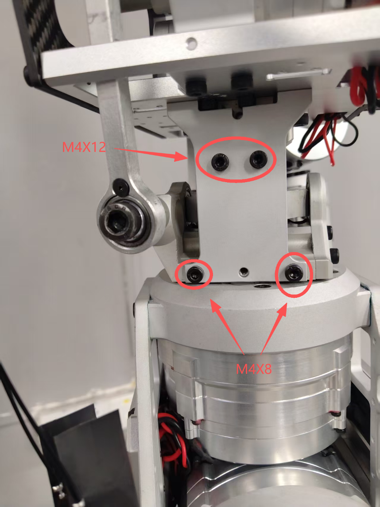{ width="500" }

### 3. Calibrate Waist Joint 3 Separately

Waist joint module 3 must be calibrated separately after whole-body calibration is complete. Before calibrating it, remove the fixtures from waist joint modules 1 and 2. Insert the locating pin into joint module 3 and confirm that the joint is locked and cannot rotate. Then use the individual joint calibration procedure to set its zero position. See “Run the Zero-Position Calibration Commands” below for the commands.

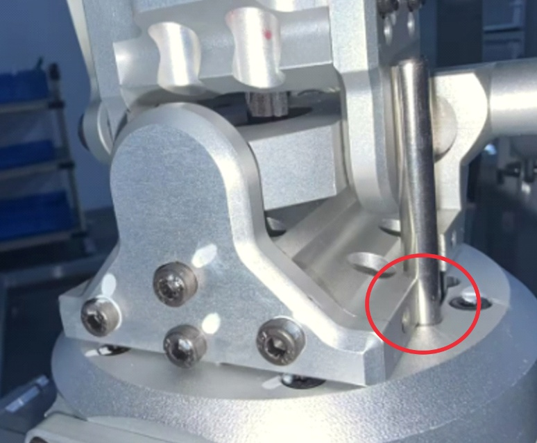{ width="600" }

!!! warning "Calibration Order"
    Calibrate waist joint module 3 separately only after whole-body calibration is complete. Remove the fixtures from waist joint modules 1 and 2 first.

## 5. Installing Leg Joint Locating Pins

### 1. Install the Leg Locating Pins

Insert the locating pins into the zero-position locating slots of leg joint modules 1, 2, 3, and 4. Labels ①–④ in the image identify these four joint modules. After inserting all pins, check each one to ensure it is seated securely. The joints must be locked and unable to rotate. Follow the same procedure for the right leg as for the left leg.

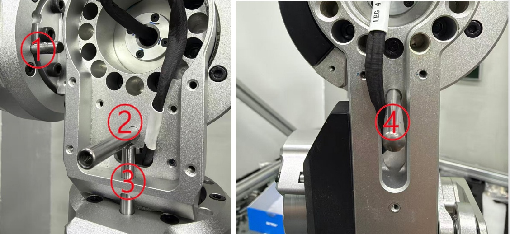

### 2. Install the Foot Fixtures

Use the foot fixture at the heel to secure the ankle. Follow the same procedure for both legs.

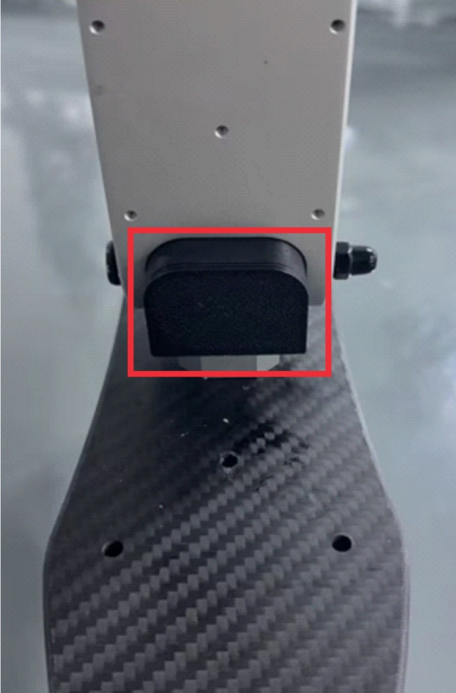{ width="400" }

## 6. Calibration from the Host Computer

### 1. Prepare the Host Computer

After installing the whole-body locating pins and fixtures, power on and perform calibration from the host computer.

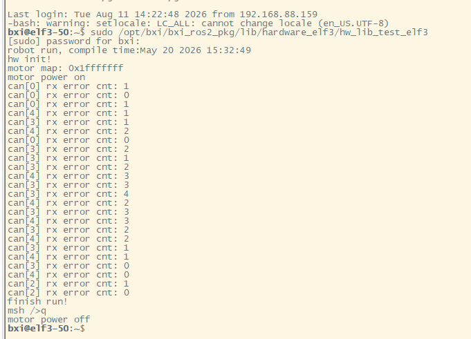{ width="680" }

### 2. Run the Power-On Command

```bash
sudo /opt/bxi/bxi_ros2_pkg/lib/hardware_elf3/hw_lib_test_elf3
```

Enter the computer password when prompted (contact the supplier to obtain it). The output `finish run!` indicates that power-on was successful.

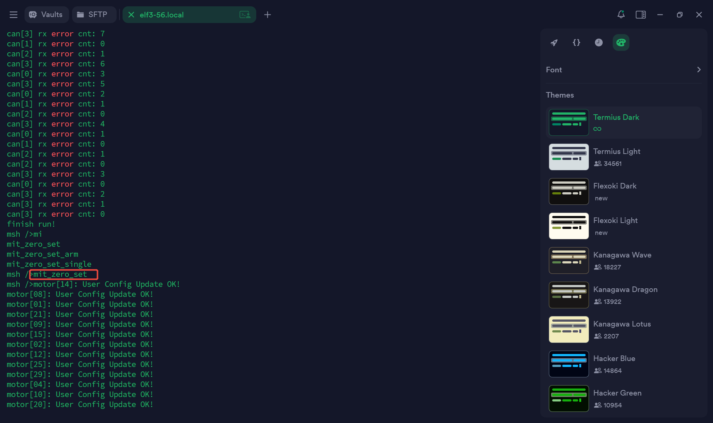

### 3. Run the Zero-Position Calibration Commands

Enter the following commands in the program's interactive terminal:

```text
mit_zero_set                 # Calibrate all body motors
mit_zero_set_single XX       # Calibrate one motor individually
```

Replace `XX` with the actual ID of the motor to calibrate. Calibrate waist joint module 3 separately after whole-body calibration, following the instructions above.

Calibration is complete when all terminal results show `ok`. For safety, **power off the robot before proceeding**.

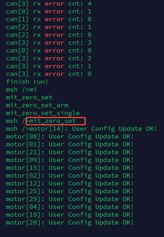{ width="400" }

### 4. Verify the Zero-Position Pose

With the robot powered off, remove all locating pins and fixtures. Power on again using the procedure above, then enter the following in the program's interactive terminal:

```text
stand_up_sh
```

The robot moves to its zero-position pose. **Keep clear of the robot while this command is running.**

Once the robot reaches its zero position, check the position of every joint module. Gently try turning each joint by hand to check its torque output. A joint that resists movement, or returns to zero after being displaced, is behaving normally.

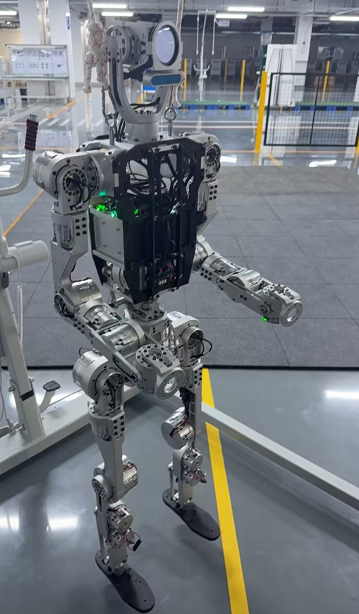{ width="400" }

### 5. Power Off

After confirming that everything is normal, enter the following in the program's interactive terminal:

```text
q
```

The output `motor power off` indicates successful power-off.

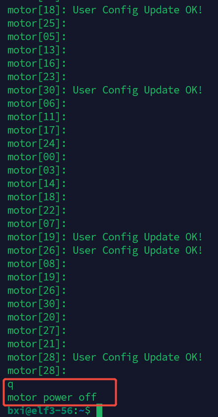{ width="400" }

!!! warning "Check Before Operation"
    After completing all steps, confirm that every fixture and locating pin has been removed before operating the robot.
