# 精灵 3整机零位校准操作指南

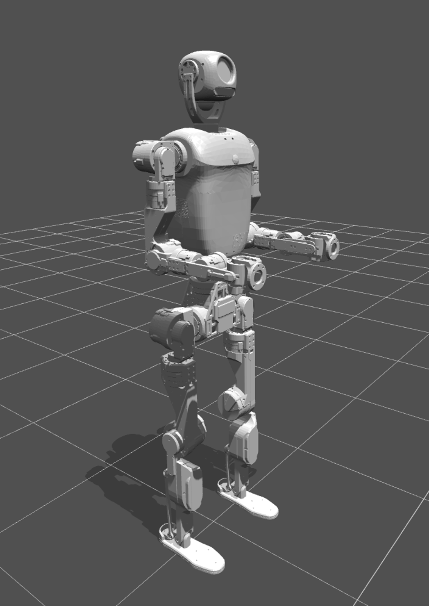{ width="400" }

## 一、整机零位校准概述

精灵 3（ELF 3）在出厂时已完成整机零位校准。若关节模组后续被拆卸并重新装配，受安装位置偏差影响，实际零位会出现失准，因此必须对关节模组重新执行零位校准。整机零位重新校准的主要流程如下：

1. **关节固定**：使用定位销和工装将关节模组锁止固定。
2. **零位设置**：上电后下发零位校准指令，完成零位参数更新。
3. **效果验证**：拆除定位销和工装，控制机器人进入零位姿态，核验机器人姿态是否符合要求。

## 二、定位销及定位工装安装位置

精灵 3（ELF 3）整机共配备 31 个关节模组。除头部 2 个关节模组外，躯体其余 29 个关节模组均预留定位销或定位工装安装位，具体位置如下图所示。

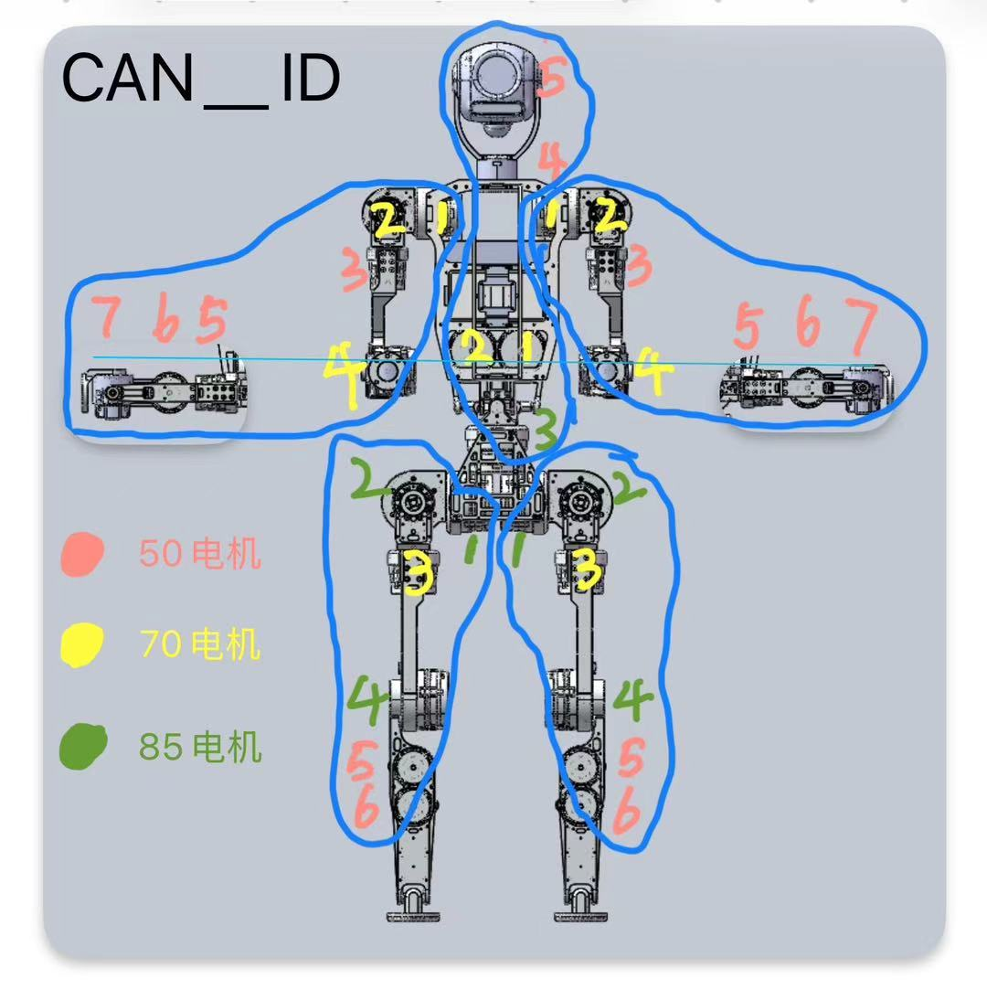{ width="600" }

## 三、手臂关节模组定位销安装

将定位插销依次插入手臂各关节模组的零位定位槽。图中 ①～⑦ 为从右肩至手腕共 7 个关节模组的定位插销示意。全部插装完成后，逐一确认所有插销就位可靠，关节应锁止、无法转动。左臂执行方式与右臂一致。

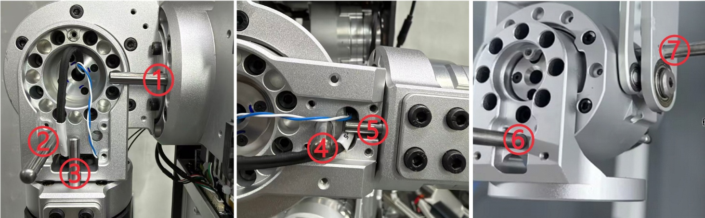

## 四、腰部关节模组定位工装安装

### 1. 安装腰部 1、2 号关节模组定位工装

腰部 1、2 号关节模组定位工装安装位置：左右两侧各一处，共需安装 2 个相同工装。

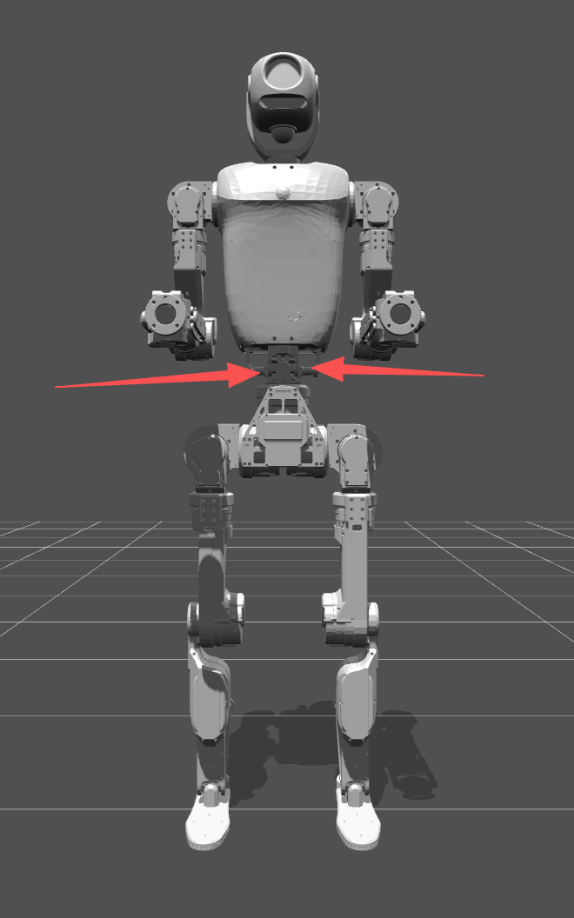{ width="400" }

### 2. 固定定位工装

腰部 1、2 号关节模组定位工装采用四颗螺丝固定，左右两侧方式相同。

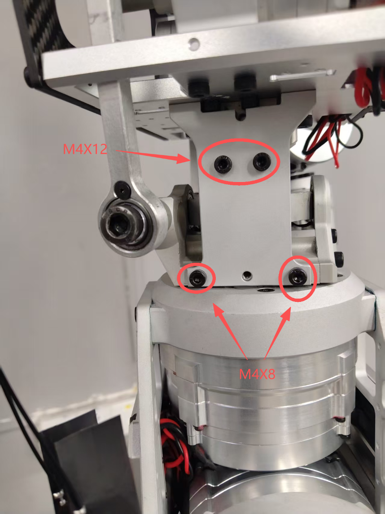{ width="500" }

### 3. 单独校准腰部 3 号关节模组

腰部 3 号关节模组的校准须在完成全身校准后单独进行。校准前先取下 1、2 号关节模组的定位工装，随后在 3 号关节模组处插入定位销，确认关节锁止、无法转动，再调用独立关节模组校准程序完成腰部 3 号关节模组的零位校准。校准命令见下文“执行零位校准命令”。

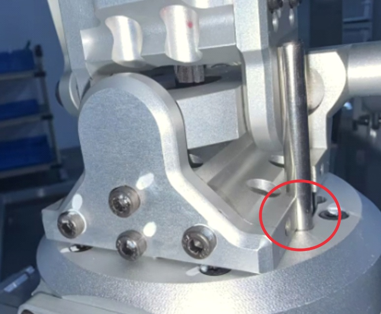{ width="600" }

!!! warning "校准顺序"
    腰部 3 号关节模组必须在全身校准完成后再单独校准，并先拆下 1、2 号关节模组的定位工装。

## 五、腿部关节模组定位销安装

### 1. 安装腿部定位销

将定位插销依次插入腿部 1、2、3、4 号关节模组的零位定位槽。图中 ①～④ 为 4 个关节模组的定位插销示意。全部插装完成后，逐一确认所有插销就位可靠，关节应锁止、无法转动。右腿执行方式与左腿一致。

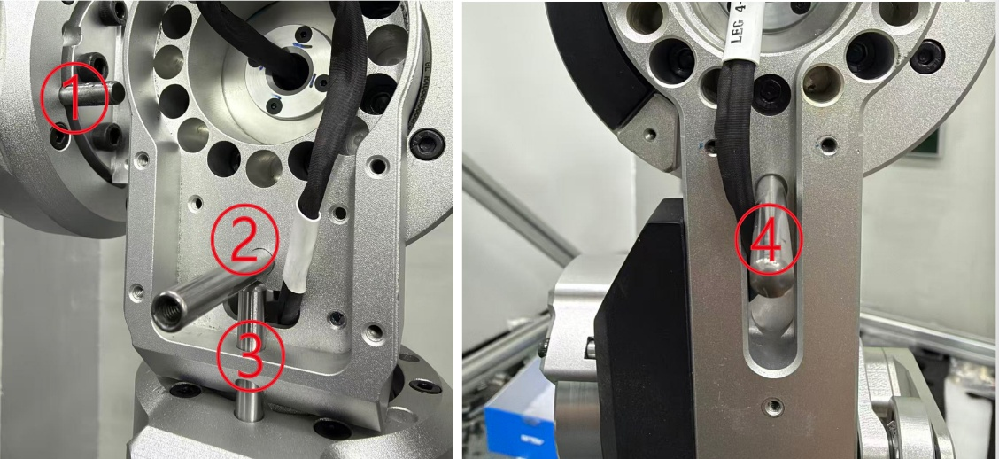

### 2. 安装脚部工装

脚跟位置使用脚部工装卡住脚踝，左右腿执行方式相同。

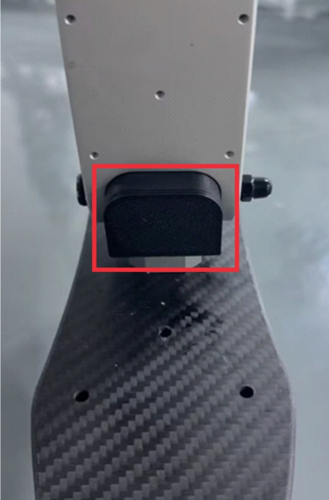{ width="400" }

## 六、上位机校准

### 1. 准备上位机

全身定位销插装及定位工装安装完成后上电，通过上位机对整机进行校准。

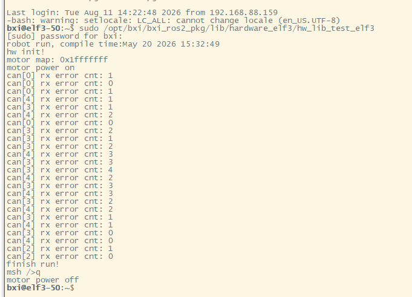{ width="680" }

### 2. 执行上电命令

```bash
sudo /opt/bxi/bxi_ros2_pkg/lib/hardware_elf3/hw_lib_test_elf3
```

按提示输入电脑密码（联系供应商获取）。当输出 `finish run!` 时，表示上电成功。

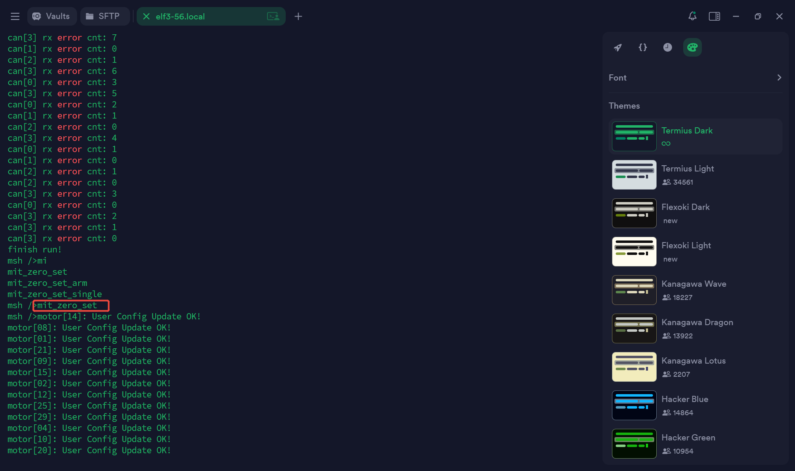

### 3. 执行零位校准命令

在程序交互终端中执行：

```text
mit_zero_set                 # 校准全身电机
mit_zero_set_single XX       # 单独校准某一电机
```

`XX` 为待校准电机的实际编号。腰部 3 号关节模组按上文要求，在全身校准完成后单独校准。

当终端全部显示 `ok` 时，表示校准完成。该步完成后，为保障安全，**先将机器人下电，再进行后续操作**。

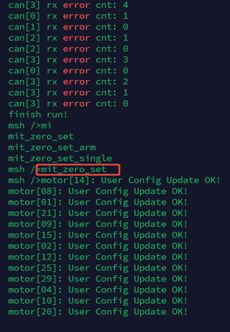{ width="400" }

### 4. 验证零位姿态

在下电状态下拆除全身定位销和定位工装。按上述上电步骤重新上电后，在程序交互终端中输入：

```text
stand_up_sh
```

机器人进入零位状态。**执行时，人员不要靠近机器人。**

机器人归零后，需逐一确认各关节模组位置是否正常，并手动试转检查其力矩输出是否到位。关节模组无法掰动，或存在位移后能够回到零位，均属正常现象。

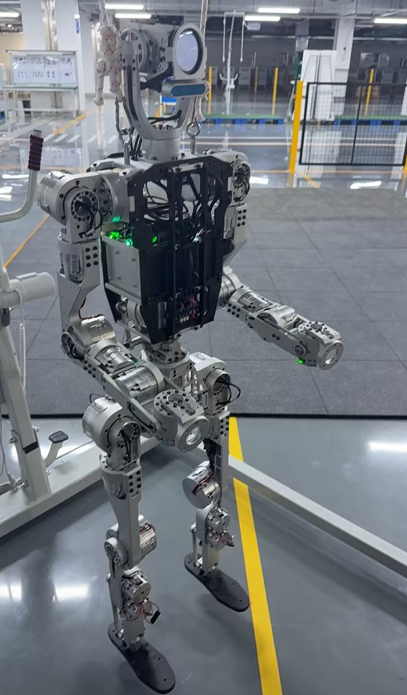{ width="400" }

### 5. 下电

全部正常后，在程序交互终端中输入：

```text
q
```

出现 `motor power off` 表示下电成功。

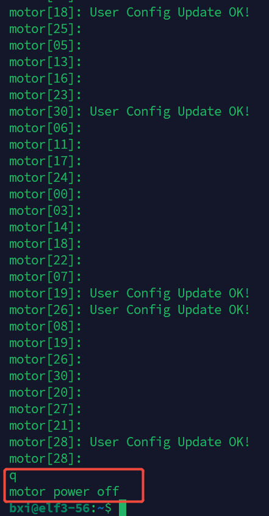{ width="400" }

!!! warning "运行前检查"
    完成所有步骤后，务必确认全部工装与定位销均已拆除，再运行机器人。
