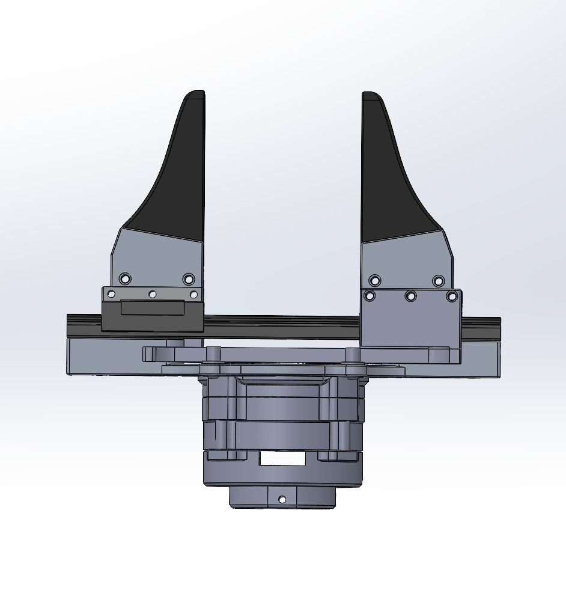
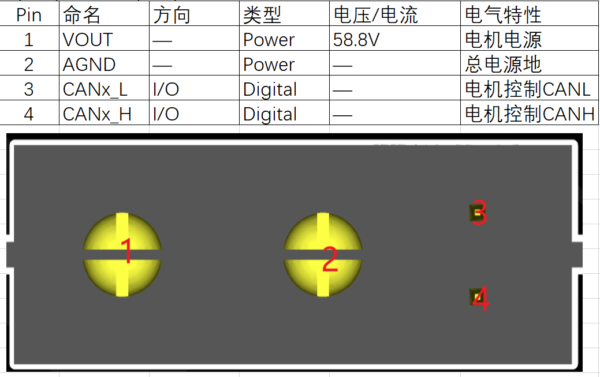
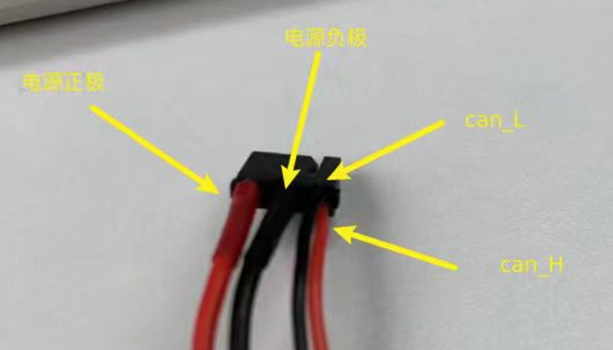

# 夹爪介绍

夹爪模组采用 BXI 夹爪电机固件，面向夹持、开合和末端执行器应用。

## 接入方式及接口定义

{ width="500" }

### 接入机器人

机器人为夹爪预留了独立 CAN 通道，夹爪需从主控板 CAN 口接入：

- **左夹爪：接主控板 `CAN5`。**
- **右夹爪：接主控板 `CAN6`。**

**不得从机器人手臂末端的电机直接接入夹爪。**

### CAN 接口定义

| Pin | 名称 | 方向 | 类型 | 电压/电流 | 电气特性 |
| --- | --- | --- | --- | --- | --- |
| 1 | `VOUT` | — | Power | 58.8 V | 电机电源 |
| 2 | `AGND` | — | Power | — | 总电源地 |
| 3 | `CANx_L` | I/O | Digital | — | 电机控制 CANL |
| 4 | `CANx_H` | I/O | Digital | — | 电机控制 CANH |

接口针脚位置如下图所示：

### 电机连接线束接口定义

线束包含电源正极、电源负极、`CAN_L` 和 `CAN_H`，对应位置如下图所示：

## 主要特性

- 使用 CAN / CAN FD 总线通信。
- 支持 MIT 控制模式。
- MIT 控制帧直接使用位置、速度和夹爪力等物理量。
- 位置单位为 mm，速度单位为 mm/s，前馈力单位为 N。
- 支持运行状态、温度和 AUX 轮询数据反馈。

## 主要参数

| 参数 | 范围或规格 | 推荐值 | 说明 |
| --- | --- | ---: | --- |
| 位置 | 闭合为 `0 mm`，张开约 `70 mm` | — | 实际位置以夹爪机构为准 |
| 协议编码范围 | `0～90 mm` | — | 固件协议映射范围 |
| 最大力 | 50：约 `16.37 N`；50L：约 `24.03 N` | — | 正力闭合，负力张开 |
| `kp` | `0～5` | `2` | 位置刚度参数 |
| `kd` | `0～1` | `0.05` | 速度阻尼参数 |
| MIT 控制帧 | 8 字节 | — | 标准 11 位 CAN ID |

50 和 50L 夹爪的理论前馈力范围不同，实际可用夹持力还会受到机械结构、供电和温度保护影响。具体通信范围、帧格式和寄存器定义请参阅[夹爪通信说明](communication.md)。

## 使用建议

1. 首次使用前确认夹爪零位、开合方向和机械限位。
2. 初始控制参数建议使用 `kp=2`、`kd=0.05`。
3. 从较低目标速度和较小前馈力开始调试，再根据实际响应调整参数。
4. 使用位置 `0 mm` 表示闭合，约 `70 mm` 表示张开；不要将协议位置上限 `90 mm` 直接当作机械开合位置。
5. 多个夹爪同时使用时，应为每个设备配置不冲突的 CAN ID。

## 相关文档

- [夹爪通信说明](communication.md)
